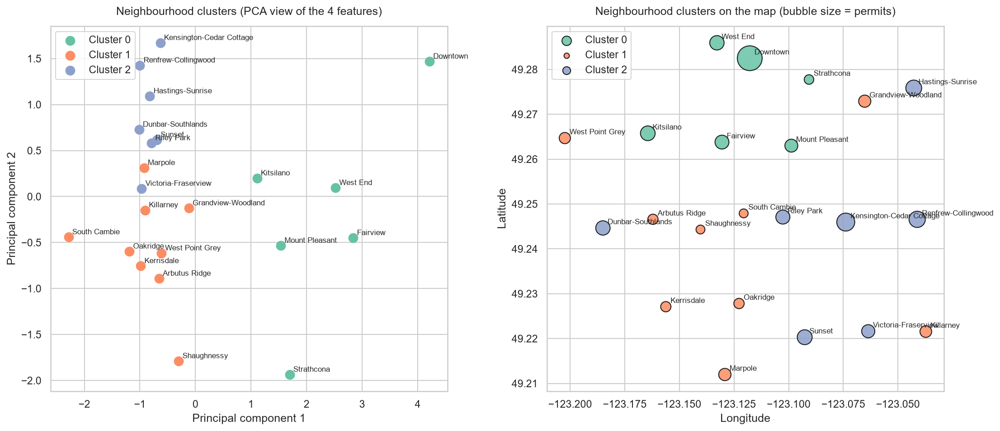
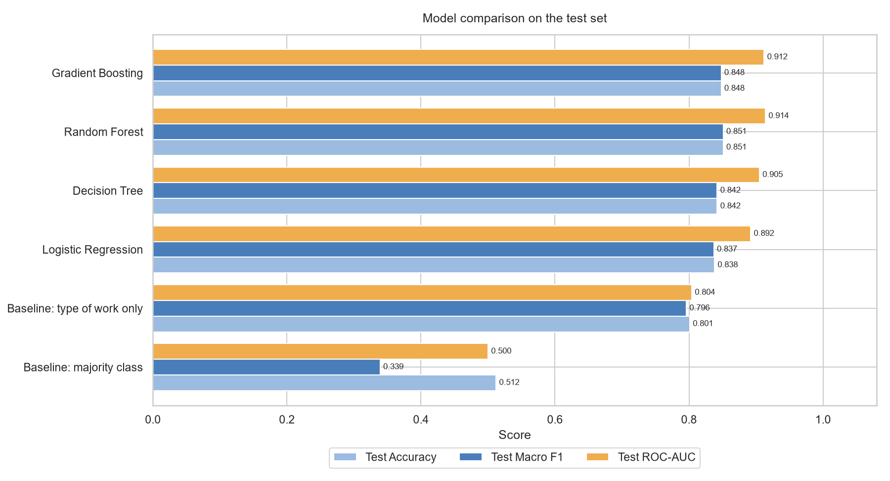
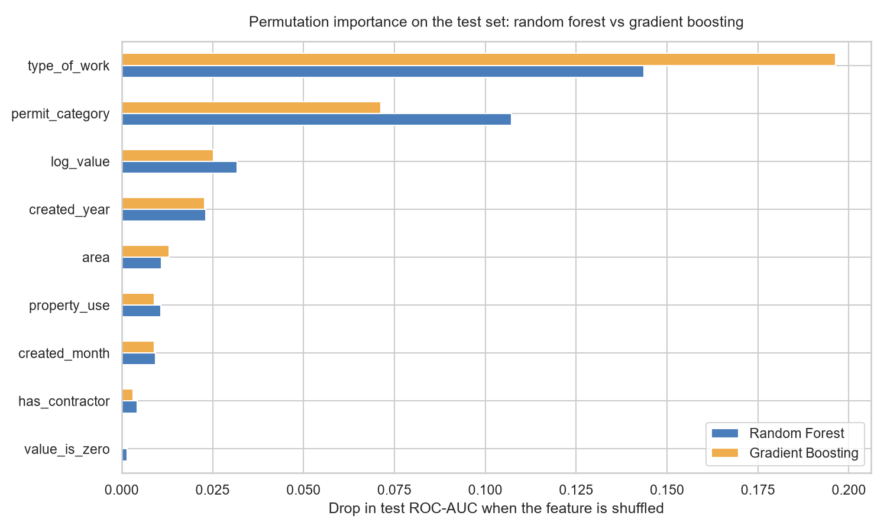

# Predicting Building Permit Delays in Vancouver

A data analytics group project that predicts whether a City of Vancouver building permit will be **processed on time** or **delayed**, using only information known when the application is made.

> Course: `Fundamentals of Data Analytics` · Douglas College · Fall 2026
> Team: `Manbir Singh`, `Ahmed Adib`, `Sachin Dogra`, `Abhilash Ravindranathan`

---

## Problem statement

Building permit delays affect housing supply, construction costs and project timelines, and applicants have little visibility into which projects are likely to wait longer.

This project uses issued building permits from the City of Vancouver Open Data Portal to build and compare classification models that predict whether a permit is processed **within 85 days** (the median processing time) or not. It also identifies which project characteristics are most associated with delays.

**Target variable:** `on_time`
- `1` = issued within 85 days of application
- `0` = delayed (more than 85 days)

---

## Dataset

| | |
|---|---|
| Source | City of Vancouver Open Data Portal – *Issued Building Permits* |
| Link | https://opendata.vancouver.ca/explore/dataset/issued-building-permits/ |
| Raw size | 52,199 permits, 20 columns |
| After cleaning | 47,438 permits (created 2017–2025), 14 columns |
| Class balance | 51.2% on time / 48.8% delayed |

The raw file is also stored in this repository. Download it from the link above to verify and you can place it in `data/raw/` as `issued-building-permits.xlsx`.

---

## Repository structure

```
├── README.md
├── requirements.txt
├── code/
│   ├── 01_cleaning.ipynb        # cleaning + target construction
│   ├── 02_main_analysis.ipynb   # EDA charts + 70/30 train/test split
│   ├── 03_models.ipynb          # classification models + comparison
│   └── 04_clustering.ipynb      # K-Means clustering of neighbourhoods
├── data/
│   ├── raw/                     # original download
│   ├── clean/                   # permits_clean.csv, cleaning_log.csv
│   └── split/                   # train.csv, test.csv (70/30)
├── outputs/
│   └── figures/                 # all saved charts
├── decisions_log.md             # every modelling decision and its reason
│            
└── slides/                      # presentation
```

---

## Methodology

### 1. Data cleaning
- Parsed dates and confirmed there were no duplicates or negative processing times.
- Built the `on_time` target from `PermitElapsedDays` (threshold = 85 days, the full-file median).
- **Restricted to permits created 2017–2025.** The file only contains permits *issued* from 2017 onward and was extracted in September 2026, so earlier applications appear only if they were very slow, and 2026 applications appear only if already issued. Keeping them would bias the target.
- Log-transformed project value (heavily skewed, up to $1.47 billion) and flagged zero values (15.6%).
- Filled missing categories with "Unknown", replaced the contractor name with a `has_contractor` flag, and grouped rare property uses into "Other".
- **Removed leakage columns:** `IssueDate` combined with the application date reproduces the target exactly, so it was dropped along with other identifier and free-text columns.

Every step and its row count is recorded in `data/clean/cleaning_log.csv`; the reasoning is in `decisions_log.md`.

### 2. Exploratory data analysis
Charts covering the target distribution, on-time rates by type of work, permit category, neighbourhood and property use, project value bands, contractor, year and month trends, a correlation heatmap and a map of permits.

### 3. Modelling setup
- **Features (9):** 4 categorical (`type_of_work`, `property_use`, `area`, `permit_category`) and 5 numeric (`log_value`, `value_is_zero`, `has_contractor`, `created_month`, `created_year`).
- **Split:** 70% train / 30% test, stratified on the target, `random_state=42`, made once and shared by all models.
- **Evaluation:** 5-fold stratified cross-validation on the training set, then a single final evaluation on the test set. Metrics: accuracy, macro F1, ROC-AUC, and precision/recall/F1 for both classes.
- All preprocessing is fitted inside pipelines on the training data only.

### 4. Classification models
| Model | Tuning |
|---|---|
| Logistic Regression | Baseline, no tuning |
| Decision Tree | Grid search (depth, min samples per leaf, criterion) |
| Random Forest | Randomized search (14 combinations) |
| Gradient Boosting (`HistGradientBoostingClassifier`) | Randomized search (15 combinations) |

### 5. Clustering
K-Means (k = 3) on profiles of Vancouver's 22 neighbourhoods, using permit volume, share of alterations,
median project value and on-time rate (standardised). k was chosen with a dendrogram, elbow chart and silhouette score.

| Cluster | Neighbourhoods | Profile |
|---|---|---|
| Central / commercial | Downtown, Fairview, Kitsilano, Mount Pleasant, Strathcona, West End | 84% alterations, median 53 days, 69% on time |
| Quieter residential | Arbutus Ridge, Grandview-Woodland, Kerrisdale, Killarney, Marpole, Oakridge, Shaughnessy, South Cambie, West Point Grey | More new buildings (29%), median 113 days, 41% on time |
| Busy residential | Dunbar-Southlands, Hastings-Sunrise, Kensington-Cedar Cottage, Renfrew-Collingwood, Riley Park, Sunset, Victoria-Fraserview | Most new buildings (35%), highest volume, median 123 days, 37% on time |

Neighbourhood differences in processing time mostly reflect the type of work done there, consistent with the classification results.



## Results

Test-set performance (14,232 permits):

| Model | Accuracy | Macro F1 | ROC-AUC |
|---|---|---|---|
| Baseline: majority class | 0.512 | 0.339 | 0.500 |
| Baseline: type of work only | 0.801 | 0.796 | 0.804 |
| Logistic Regression | 0.838 | 0.837 | 0.892 |
| Decision Tree | 0.842 | 0.842 | 0.905 |
| **Random Forest** | **0.851** | **0.851** | **0.914** |
| Gradient Boosting | 0.848 | 0.848 | 0.912 |



### Key findings
- **Random forest performed best**, with gradient boosting essentially tied. All models clearly beat both baselines.
- **Type of work and permit category drive the predictions.** New buildings (8% on time) and demolitions (13%) are usually delayed; renovations and temporary structures are usually on time.
- **Project value and application year come next.** Location, property use and contractor add little once the project type is known.
- Cross-validation and test scores agree closely (CV standard deviation ≤ 0.004), so the models are stable and not overfitting.



### Limitations
- Only issued permits are included; withdrawn or still-pending applications are missing.
- Permits created late in 2025 may still be slightly under-represented if they were slow.
- Results show associations in historical data, not the causes of delays.

---

## How to run

1. **Install Python 3** and the required packages (from the project folder, in CMD):
   ```
   pip install -r requirements.txt
   ```
2. **Download the raw data** from the link above and save it as `data/raw/issued-building-permits.xlsx`.
3. **Run the notebooks in order** from the `code/` folder:
   1. `01_cleaning.ipynb` → creates `data/clean/permits_clean.csv`
   2. `02_main_analysis.ipynb` → creates the EDA charts and `data/split/train.csv`, `test.csv`
   3. `03_models.ipynb` → trains and evaluates the models
   4. `04_clustering.ipynb` → clustering analysis

Use **Restart Kernel and Run All** for each notebook. Charts are saved to `outputs/figures/`. The random forest search takes roughly 10 minutes.

---

## Tools

Python · pandas · NumPy · scikit-learn · Matplotlib · seaborn · Jupyter (VS Code)

---

*This repository is coursework for a group project and is shared for review purposes only.*
